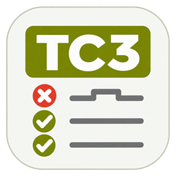
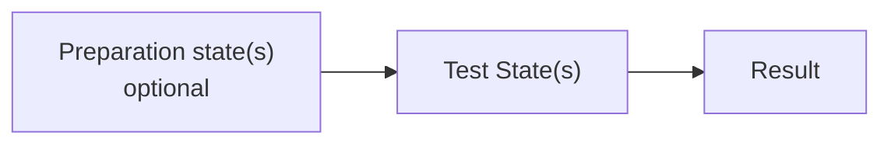

  

<h1 align="center">TC3 UnitTest</h1>

  <strong>Unit testing and behavior analysis framework for Beckhoff TwinCAT 3.</strong>

  
  
  

**Build repeatable tests for your TwinCAT libraries.** TC3 UnitTest is a Structured
Text framework for testing PLC logic and analyzing its behavior in the PLC runtime.

- **Verify logic and data:** check function results, limits, tolerances, arrays, and text.
- **Analyze cyclic behavior:** observe signal changes, edges, sequences, and stability over defined intervals.
- **Reuse test scenarios:** bind tests to different component instances and parameters, then repeat them after code changes.
- **Use the same tests in development and CI:** [PLCSIM.UnitTest](https://github.com/Lorenz-Software/PLCSIM.UnitTest) provides the WPF workbench for interactive runs and debugging, plus the CLI for automated regression testing.

## Framework Overview

- **A Test Case describes one scenario.** Preparations establish its starting conditions; Assertions evaluate its expectations.
- **Suites and Run Control compose the application.** Suites collect related Test Cases, and Run Control coordinates those Suites through the supplied orchestration.
- **A shared Event Buffer connects the tests to the PC.** Framework blocks publish lifecycle events, findings, and results for the PC application to evaluate.

The [Framework Model](docs/authoring/framework-model.md) describes how these
components cooperate and where each responsibility belongs.

> **Complete API documentation**
>
> The [offline HTML reference](tools/documentation/README.md#regeneration-and-delivery)
> covers blocks, interfaces, methods, and properties, with shared search and
> linked authoring guides and integration examples.

## Test Cases

The same `TestCaseBase` supports immediate value checks and scenarios spanning
many PLC cycles:

- **You define:** stimuli, Assertions, phase completion, and resource cleanup.
- **The base provides:** the lifecycle Sequencer, Start/Reset/Abort handling, timeout supervision, result aggregation, and event reporting.

| Test scenario | Typical use |
| --- | --- |
| **Static checks** | Evaluate a calculation, value, or data structure. |
| **Single Test State** | Observe one condition over time, such as stable feedback or an edge count. |
| **Multiple Test States** | Apply successive stimuli and evaluate a different expectation in each phase. |

Preparation is optional. Each Test State can finish after one evaluation or remain
active across the PLC cycles needed for its observation window.

### Preparations

Preparations make the required starting condition part of the test. Reusable
resource setup, optionally based on `PreparationBase`, gives repeated runs a
consistent starting point.

### Assertions

Choose typed Assertions for the behavior or data you want to verify:

| Check family | Coverage |
| --- | --- |
| Boolean and numeric | Conditions, comparisons, limits, ranges, tolerances |
| Floating-point classification | Finite values, NaN, infinity; scalar and array checks |
| Bits and masks | Individual flags and bitfield expectations |
| Arrays | Equality, contained values and patterns, unchanged snapshots |
| Text and tokens | Strings, character codes, array/text checks, token positions and counts |
| Signals and sequences | No-change checks, edges, edge counts, ordered values |
| Time and dates | Durations, calendar values, time of day |

Each check has a name and a retained result, so failed expectations remain
identifiable. The [Assertion catalogue](docs/authoring/assertions.md#select-by-intent-and-datatype)
helps select the matching family and datatype.

## Test Suites and Run Control

- **`TestSuiteBase`** collects related Test Cases, schedules their execution, and aggregates their results.
- **`RunControlBase`** combines Suites into the complete test application and connects it to external run commands.

Both bases include lifecycle **Sequencers** and collection **Orchestrators**.
Choose **Serial**, **Parallel**, or **ParallelSlots** to run children in order,
overlap independent tests, or arrange concurrent groups.

You declare, register, and cyclically call the children. The framework schedules
them in one PLC task; you coordinate shared resources.

## Event Buffer and PC Integration

- **Automatic reporting:** the base blocks and Assertions generate and publish their standard events. Normal tests need no manual event creation.
- **Independent storage:** a shared Event Buffer retains the events for PC readout. Wire it once in the application; individual tests need no buffer management or transport code.
- **Ready-made constructors:** supplied functions create event payloads for custom extensions, including triggers, state transitions, results, and diagnostics. See the [event function catalogue](docs/framework-architecture.md#event-construction-functions).

The companion [PLCSIM.UnitTest](https://github.com/Lorenz-Software/PLCSIM.UnitTest)
application reads and acknowledges the events through its TwinCAT profile and
turns them into test results:

- **WPF workbench:** repeat scenarios during library development, inspect failed checks, and follow lifecycle events as an additional debugging workflow.
- **CLI automation:** execute the same PLC tests in CI, with exit codes for the job result and JUnit XML for reporting. The [CI starters](https://github.com/Lorenz-Software/PLCSIM.UnitTest/blob/main/src/PLCSIM.UnitTest.App.Cli/examples/ci/README.md) cover runner preparation and integration.

Authoring examples and integration strategies cover every level, from an
individual Test Case to a complete application with command and Event Buffer wiring.

## Example: Testing a Valve Controller

Consider an opening test with two requirements: open feedback must arrive within
**500 ms** and then remain stable for **2 s**. Preparation and two Test States
express that scenario:

| Phase | Scenario logic | Expected observation |
| --- | --- | --- |
| **Preparation** | Establish the closed starting condition. | `ClosedFeedback = TRUE` and `OpenFeedback = FALSE`. |
| **Test State 1** | Set `OpenCommand := TRUE` and measure the response. | `OpenFeedback` becomes TRUE within 500 ms. |
| **Test State 2** | Keep the command active and observe the feedback for 2 s. | `OpenFeedback` remains TRUE throughout the interval. |

The Test Case defines the command sequence and observation windows. Two named
Assertions, `OpensWithinDeadline` and `OpenFeedbackStable`, distinguish a missed
deadline from feedback that drops out during the hold interval.

- **Reuse the scenario:** bind separate test instances to other valves and timing parameters.
- **Repeat it after changes:** add the case to a Suite for WPF development runs and CLI regression checks. Results reach the PC application through the shared Event Buffer.

## Project Status

- **Release:** initial public release packaging is being prepared.
- **Planned assets:** Framework-only `.compiled-library` and `.library` packages plus offline HTML help.
- **Source:** the [solution](projects/Tc3UnitTest.4026/Tc3UnitTest.4026.sln) includes Framework, SelfTests, and Runtime.
- **Target:** TwinCAT 3.1 Build 4026; documented consumer validation covers Windows Usermode Runtime / x64. See the [build workflow](docs/build-workflow.md) for dependencies and verification scope.

## Further Reading

- [Test Case guide](docs/authoring/test-case.md), [Preparations](docs/authoring/preparation.md), and [Assertions](docs/authoring/assertions.md): implementation examples and check selection.
- [Test Suites](docs/authoring/test-suite.md) and [Run Control](docs/authoring/run-control.md): collections, orchestration, and complete PLC/PC integration.
- [Library installation](docs/authoring/framework-model.md#using-the-packaged-library) and [offline HTML help](tools/documentation/README.md): consuming the library and reading its API documentation.
- [Architecture](docs/framework-architecture.md), [public contracts](contracts/README.md), and [selftest strategy](docs/selftest-strategy.md): design and verification details.
- [AI-assisted authoring](docs/authoring/ai-assisted-framework-authoring.md) and [authoring skill](skills/tc3unittest-framework-authoring/SKILL.md): optional assistance using the framework patterns.

## License

Created by [Lorenz Software](https://www.lorenz-software.solutions/) and available
under the [MIT license](LICENSE).
